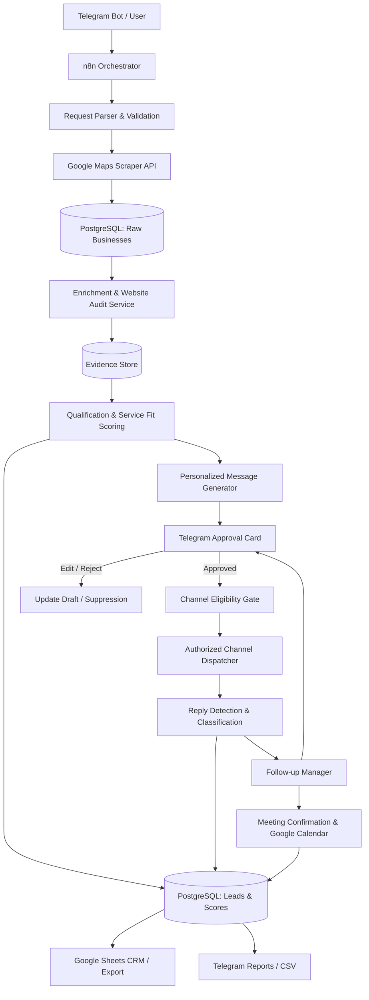

# IntentLead AI — System Architecture

## 1. Product definition

IntentLead AI is a Telegram-controlled prospecting and sales-operations system for an agency initially targeting real-estate businesses. It combines Google Maps business discovery with evidence-based enrichment and qualification.

It must not behave as a blind bulk scraper or generic cold-email sender. The system should explain **why** a prospect is relevant, **what evidence** supports that conclusion, **which agency service** is the best fit, and **which outreach channels** are eligible.

### Primary business objective

Support an agency model targeting approximately USD 500/month per client and a USD 3,000/month recurring-revenue goal. These are business targets, not guaranteed outcomes.

### Services offered

1. Website development and redesign.
2. Real-estate property-listing websites.
3. AI chatbots.
4. Business-process automation.
5. Lead management and customer follow-up automation.
6. CRM and appointment-booking automation.

## 2. Architecture at a glance



## 3. Components and responsibilities

### 3.1 Telegram control plane

Telegram is the operator interface. It accepts natural-language requests and commands, reports progress, and presents inline approval cards.

Example request:

```text
/findleads
Niche: Real Estate Agencies
Location: Dallas, Texas
Quantity: 100
Services: Website development, property listing portals, AI chatbots,
CRM automation, appointment booking
Filters: Include businesses with a website; prioritize visible website
and lead-capture gaps
```

Telegram responsibilities:
- Parse and confirm niche, location, quantity, filters, and service targets.
- Start, pause, resume, and cancel discovery jobs.
- Display progress and qualified lead summaries.
- Present message/reply approval cards.
- Show meeting and follow-up summaries.
- Restrict privileged actions to configured Telegram user IDs.

Suggested commands:
- `/findleads` — start a discovery request.
- `/status` — current job status.
- `/pause` and `/resume` — pause/resume a campaign.
- `/showpriority A` — show top-priority leads.
- `/approve_campaign` — approve a reviewed batch.
- `/show_replies` — list new replies.
- `/pending_followups` — show due follow-ups.
- `/stop_contact <lead_id>` — suppress future contact.
- `/sales_report` — pipeline and conversion report.
- `/export_csv` — export selected leads.

### 3.2 n8n orchestrator

n8n coordinates the workflows and integrations. Keep business logic that needs unit tests in the Python service rather than embedding large code blocks in many Code nodes.

n8n handles:
- Telegram triggers and callbacks.
- HTTP calls to the scraper and intelligence API.
- Job state transitions and retries.
- Approval callback routing.
- CRM/Google Sheets synchronization.
- Calendar integration.
- Scheduled reply polling where webhook subscriptions are unavailable.
- Notifications and error handling.

### 3.3 Primary discovery engine — Google Maps Scraper

Repository: https://github.com/gosom/google-maps-scraper

Use this as the **primary business discovery engine**. It can provide fields such as business title, category, address, website, phone, review count/rating, coordinates, business status, reviews, and optional email extraction from business websites (depending on current configuration and supported options).

Preferred integration:
1. Run the scraper's supported REST API/web service.
2. Create a scrape job through the API.
3. Poll job status or consume completion output.
4. Normalize records into the IntentLead schema.
5. Deduplicate before enrichment.

Do not assume every field is always present. Preserve source fields and timestamps. The scraper finds businesses; it does not by itself establish a need for the agency's services or prove buying intent.

### 3.4 Reference research logic — First Customer Finder

Repository: https://github.com/Kappaemme-git/codex-first-customer-finder-skill

This is a **reference-only learning source**, not the primary engine and not a runtime dependency.

Study and independently adapt these ideas:
- Evidence-first research with original source URLs.
- Explicit distinction between observed facts and inference.
- Weighted scoring with per-dimension explanations.
- Missing/weak evidence should reduce confidence or score.
- Deduplication and stable prospect IDs.
- Feedback/history so rejected or contacted prospects are not repeatedly surfaced.
- Structured Markdown/CSV reports.
- Honest handling of missing or inaccessible sources.
- Never equate a public contact route with consent to advertise.

Do not copy its source files into this project without checking license notices and deciding whether code reuse is necessary. Prefer implementing the useful concepts in the IntentLead Python service and writing tests around them.

### 3.5 Enrichment and audit service

Python/FastAPI service. Responsibilities:
- Normalize and validate scraper results.
- Inspect publicly accessible business websites.
- Record visible website and lead-capture observations.
- Extract relevant public evidence from accessible pages and reviews.
- Validate source URLs and timestamps.
- Mark each finding as `verified_observation`, `inference`, or `explicit_intent`.
- Store confidence and source provenance.
- Return structured audit data, not free-form claims only.

Potential website checks:
- HTTP reachability and redirect status.
- Mobile viewport / responsive indicators.
- Page title, service content, visible navigation.
- Property listing pages and search/filter controls.
- Inquiry forms and calls to action.
- Visible WhatsApp/contact links.
- Publicly visible chatbot or booking widget.
- Basic performance/accessibility checks where practical.

A visible absence is not proof of a business process failure. For example, not seeing a chatbot on the homepage does not prove the company has no chatbot on another page or channel.

### 3.6 AI qualification and scoring

Use deterministic weighted scoring over validated structured evidence. The LLM may extract/classify evidence and explain the score, but should not invent or arbitrarily set the numeric score.

Output:
- Overall lead-priority score (0–100).
- Per-service fit scores (0–100).
- Priority band.
- Evidence list with source URLs.
- Confidence.
- Recommended service and rationale.
- Disqualifiers and unresolved unknowns.

The score is a research/prioritization heuristic, **not a probability of closing**.

### 3.7 Outreach generation and approval

Generate a message that:
- References a specific, verified observation.
- Avoids claiming hidden facts or unverified problems.
- Makes one relevant service offer.
- Uses a low-friction, truthful CTA.
- Identifies the sender accurately.
- Includes opt-out language where required.

Telegram approval card should show:
- Prospect name and location.
- Overall score and service-fit score.
- Recommended service.
- Evidence and confidence.
- Channel, recipient, and eligibility status.
- Full message preview.
- Buttons: `Approve & Send`, `Edit`, `Reject`, `View Lead`.

Approval requirements:
- Only authorized Telegram user IDs may approve.
- Approval is bound to a specific lead, channel, and message version.
- Approval tokens expire.
- Re-check opt-out, eligibility, and suppression immediately before dispatch.
- Enforce idempotency so double-clicks/retries do not duplicate sends.
- Rejected or suppressed leads cannot be sent accidentally.

### 3.8 Channel dispatchers

Use official APIs and authorized integrations only. Public contact information is not automatically consent for promotional email, WhatsApp, SMS, or social DMs.

Channel policy:
- Email: use a legitimate business sending identity, SPF/DKIM/DMARC, compliant provider, unsubscribe/suppression handling, and bounce/complaint monitoring.
- WhatsApp: use the official WhatsApp Business Platform and applicable opt-in/template rules. Do not automate personal WhatsApp Web or bypass restrictions.
- SMS: only where lawful and consent requirements are satisfied.
- Social platforms: use official APIs or manual drafts where automated messaging is unsupported or prohibited.
- If no compliant automated route exists, create a draft and ask the operator to handle it manually.

Never use identity rotation, deceptive headers, spoofing, or spam-filter evasion. No system can guarantee inbox placement.

### 3.9 Reply detection and follow-up manager

Monitor only connected and authorized channels. Classify inbound replies:
- `interested`
- `pricing_request`
- `portfolio_request`
- `meeting_request`
- `later`
- `objection`
- `not_interested`
- `opt_out`
- `wrong_person`
- `unclear`

Rules:
- Stop scheduled follow-ups on any reply until the reply is classified and handled.
- Stop immediately for opt-out, complaint, not-interested, or wrong-person requests as appropriate.
- Never follow up after a meeting is booked unless a separate, relevant reminder is required.
- Suggested AI replies require Telegram approval initially.
- Record inbound message IDs to prevent duplicate processing.

A configurable follow-up schedule (for example, Day 0, Day 3, Day 7) is only a starting policy. Apply provider rules, local law, recipient preferences, and campaign-level limits. Do not send if the channel is ineligible.

### 3.10 Meeting booking and Google Calendar

Create a calendar event only when the prospect has clearly agreed to a specific date/time and the booking is confirmed.

Workflow:
1. Detect a meeting request or agreement.
2. Extract date, time, timezone, duration, attendees, and meeting purpose.
3. Ask for clarification if any essential detail is ambiguous.
4. Check calendar availability.
5. Create the event using Google Calendar API.
6. Store the Google event ID in PostgreSQL.
7. Notify the operator in Telegram with event details and link.
8. Update CRM stage to `meeting_booked`.

Also support rescheduling and cancellation by updating/deleting the same event ID. Use an idempotency key such as `lead_id + confirmed_start_time` to prevent duplicate events. Generate a Google Meet link only when the API/account configuration supports it.

### 3.11 CRM, PostgreSQL, Google Sheets

PostgreSQL is the source of truth. Google Sheets is a convenient operator-facing CRM/export, not the only durable database.

Minimum entities:
- `campaigns`
- `businesses`
- `leads`
- `evidence`
- `service_scores`
- `contacts`
- `channel_permissions`
- `message_drafts`
- `approvals`
- `outbound_messages`
- `inbound_messages`
- `followup_tasks`
- `meetings`
- `calendar_events`
- `lead_outcomes`
- `suppression_list`
- `audit_log`

Store secrets in environment variables/credential storage, never in rows or source control.

## 4. Scoring model

### 4.1 Overall score: 100 points

| Dimension | Weight | Evidence examples |
|---|---:|---|
| Website opportunity | 25 | No website; broken/unreachable website; clearly outdated or poor mobile experience; missing relevant property features |
| Lead-capture opportunity | 20 | No visible inquiry path; broken form; unclear CTA; no obvious contact conversion route |
| Automation opportunity | 20 | Repeated public complaints or visible workflow friction that supports an automation hypothesis; do not infer internal failures from absence alone |
| Business suitability | 15 | Correct niche, active business, relevant scale/market fit, sufficient public business information |
| Buying-intent evidence | 15 | Explicit, recent public request for a provider/service or clear project trigger, with original source and date |
| Contactability | 5 | Verified public business contact route and source |

Calculate each dimension from 0 to its weight. Missing evidence should not receive full points. Contradictory or stale evidence lowers confidence.

Suggested priority bands:
- A: 80–100
- B: 65–79
- C: 45–64
- D: below 45

These bands are operational filters, not predicted close rates.

### 4.2 Service-fit scores

Calculate a separate score for each:
- `website_development`
- `website_redesign`
- `real_estate_listing_portal`
- `ai_chatbot`
- `business_process_automation`
- `lead_management_followup`
- `crm_appointment_automation`

Example: A real-estate agency with an existing but dated site and no visible property search may have a high redesign/listing-portal fit, while chatbot fit remains moderate or unknown.

### 4.3 Evidence classes

- `verified_observation`: directly inspected and supported by a source (e.g., site returns an error at audit time).
- `inference`: plausible opportunity, not confirmed internal fact (e.g., no visible booking widget found on inspected pages).
- `explicit_intent`: public statement requesting the service/provider, with original source URL and date.

Do not award buying-intent points based on Google Maps listing data alone.

### 4.4 Confidence

Confidence is independent of score:
- `high`: multiple current, direct sources; reproducible observation.
- `medium`: one direct source or partial coverage.
- `low`: indirect, stale, incomplete, or ambiguous evidence.

Every finding should contain:
```json
{
  "claim": "No property search was visible on the inspected website pages",
  "evidence_type": "verified_observation",
  "source_url": "https://example.com/",
  "checked_at": "2026-11-08T10:00:00Z",
  "confidence": "medium",
  "scope": "homepage and navigation-linked pages inspected"
}
```

## 5. n8n workflow plan

Implement as eight logical workflows (some can be split into sub-workflows later).

1. **Telegram Command & Request Parser** — validate request, create campaign.
2. **Google Maps Discovery** — call scraper API, poll results, normalize/dedupe.
3. **Business Enrichment & Website Audit** — gather and store public evidence.
4. **AI Qualification & Lead Scoring** — compute deterministic scores and service fit.
5. **Personalized Outreach Generator** — create drafts tied to evidence.
6. **Telegram Approval & Outreach Dispatcher** — approve/edit/reject, gate, send.
7. **Reply Detection & Follow-up Manager** — classify replies, suppress, suggest response, schedule eligible follow-ups.
8. **CRM, Calendar & Reporting** — Sheets sync, Calendar event lifecycle, CSV and Telegram reports.

## 6. Suggested data contract

### Lead record (simplified)

```json
{
  "lead_id": "stable-uuid",
  "campaign_id": "stable-uuid",
  "business_name": "Example Realty",
  "category": "Real estate agency",
  "location": "Dallas, Texas",
  "website": "https://example.com",
  "phone": null,
  "email": null,
  "overall_score": 73,
  "priority": "B",
  "confidence": "medium",
  "recommended_service": "real_estate_listing_portal",
  "service_scores": {
    "website_development": 35,
    "website_redesign": 82,
    "real_estate_listing_portal": 91,
    "ai_chatbot": 55,
    "business_process_automation": 40,
    "lead_management_followup": 62,
    "crm_appointment_automation": 48
  },
  "evidence_ids": ["evidence-uuid"],
  "outreach_status": "draft",
  "crm_stage": "qualified"
}
```

### Calendar booking record (simplified)

```json
{
  "meeting_id": "stable-uuid",
  "lead_id": "stable-uuid",
  "status": "confirmed",
  "start_at": "2026-11-12T10:00:00-06:00",
  "end_at": "2026-11-12T10:30:00-06:00",
  "timezone": "America/Chicago",
  "google_calendar_event_id": "provider-event-id",
  "idempotency_key": "lead-uuid:confirmed-start-time"
}
```

## 7. Security, privacy, compliance

- Collect only public business/professional data relevant to the stated business purpose.
- Respect website terms, platform rules, robots/access restrictions where applicable, and applicable privacy/marketing law.
- Do not bypass login walls, CAPTCHAs, paywalls, or access controls.
- Do not collect sensitive personal data or target people based on sensitive traits.
- Keep a suppression list and honor opt-outs across all channels.
- Encrypt secrets and restrict credentials to least privilege.
- Restrict Telegram approvals by user ID.
- Audit every approval, dispatch, reply classification, follow-up, and calendar mutation.
- Add retention and deletion controls.
- Rate-limit requests and use conservative scrape concurrency.
- Provide a dry-run mode that never sends messages.

## 8. Reliability and observability

- Use stable IDs and unique constraints for deduplication.
- Use idempotency keys for sends, callbacks, reply ingestion, and calendar events.
- Retry transient errors with bounded exponential backoff.
- Dead-letter failed jobs for operator review.
- Record scraper job IDs and raw result snapshots.
- Record audit timestamp and source URL for every website finding.
- Pause campaigns on abnormal bounce, complaint, or provider error rates.
- Expose health endpoints for API services.
- Keep structured logs free of credentials and unnecessary personal data.

## 9. Rollout plan

### Phase 0 — Local foundation
- Clone and run the primary scraper from its official instructions.
- Verify REST API locally with a tiny test.
- Create PostgreSQL database and environment configuration.
- Set up Telegram bot and authorized user ID.

### Phase 1 — Discovery to CRM
- Build request parser and scraper integration.
- Normalize, deduplicate, and store businesses.
- Export raw leads to CSV/Google Sheets.
- No outreach.

### Phase 2 — Evidence and scoring
- Build website audit service.
- Add evidence schema and source provenance.
- Implement deterministic overall and service-fit scoring.
- Validate with manually reviewed examples.

### Phase 3 — Telegram approvals and outreach
- Generate evidence-specific drafts.
- Build approval callbacks and eligibility gates.
- Start with a tiny, manually reviewed campaign.
- Use official supported channel APIs only.

### Phase 4 — Replies and follow-ups
- Connect authorized inbound channels.
- Classify replies and stop/suppress correctly.
- Add approved reply suggestions and follow-up queue.

### Phase 5 — Calendar and reporting
- Connect Google Calendar.
- Create/update/cancel confirmed meeting events.
- Add daily pipeline reporting, exports, and monitoring.

## 10. Acceptance criteria

The MVP is not ready for live outreach until:
- A Telegram request creates a campaign with validated parameters.
- A small Google Maps scrape returns structured records.
- Duplicate businesses are consolidated.
- Every score dimension can be traced to evidence or a declared unknown.
- Verified observations, inferences, and explicit intent are distinct.
- Service-fit scores are deterministic and tested.
- Approval buttons cannot be used by unauthorized Telegram users.
- Duplicate callbacks cannot send duplicate messages.
- Opt-outs and ineligible channels are blocked.
- Reply events stop inappropriate follow-ups.
- A confirmed meeting creates exactly one Google Calendar event.
- Calendar reschedule/cancel updates the existing event.
- PostgreSQL and Sheets reflect the correct lead and meeting states.
- Dry-run mode is tested before live dispatch.
