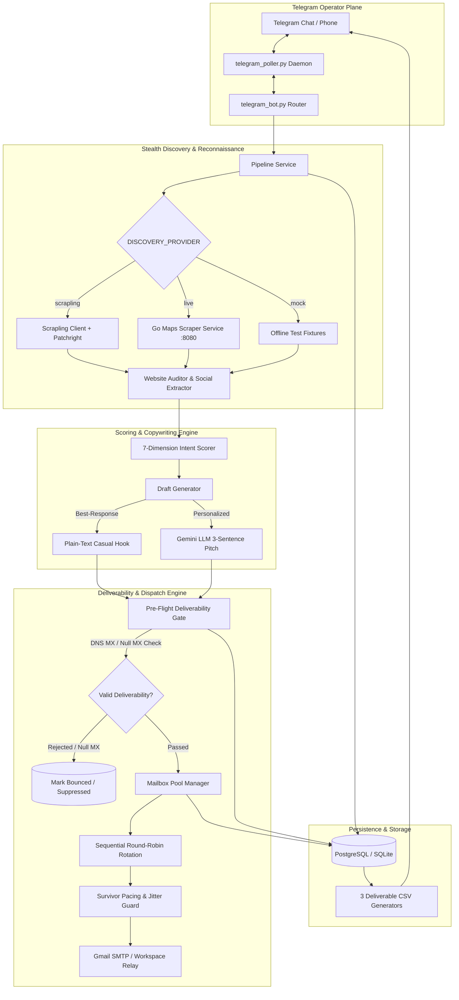

# IntentLead AI — Production System Architecture

## 1. Product Overview

IntentLead AI is an autonomous, evidence-led prospect discovery, website intelligence, and cold-outreach system. It combines stealth Google Maps scraping and deep website crawling with deterministic qualification scoring, plain-text cold email generation, and multi-mailbox Gmail pool rotation—controlled via Telegram.

The system is designed for B2B agencies and freelancers across any commercial niche (Real Estate, Legal, Healthcare, Contractors, Home Services, E-commerce, Hospitality, Financial Services).

### Core Pillars
1. **Evidence-Led Qualification:** Audits websites for explicit technology gaps (missing appointment booking, lack of 24/7 AI chat, non-responsive mobile viewports, missing lead capture).
2. **Stealth Discovery & Crawling:** Employs Scrapling with Patchright Chromium and TLS browser fingerprinting (`curl_cffi`) to harvest Google Maps listings and crawl company websites without anti-bot blocks.
3. **Pre-Flight Deliverability Gate:** Validates email syntax, checks permanent suppression lists, verifies DNS MX records, and intercepts RFC 7505 Null MX records before dispatch.
4. **Multi-Mailbox Pool Rotation:** Distributes outbound volume sequentially across an unlimited pool of connected Gmail accounts (`smtp.gmail.com:587`), enforcing 40–50 email/day safety caps and automatic survivor pacing guards (30–40s cooldown when active mailboxes drop below 3).
5. **Interactive Telegram Command Center:** Complete operator control from mobile: launch campaigns, review individual leads, approve batches, toggle Auto Mode, switch scraping engines with `/provider`, and download clean CSV deliverables.

---

## 2. End-to-End System Flow

---

## 3. Component Details

### 3.1 Telegram Control Plane (`apps/intelligence-api/app/services/telegram_bot.py`)
* **Interactive 6-Step Wizard:** Step-by-step guidance for Niche, City/Location, Target Services, Quantity, Benchmark Score, and Template Mode.
* **Dynamic Provider Switcher (`/provider`):** Live toggle between `scrapling`, `live` (Go daemon), and `mock` discovery providers, plus email dispatchers (`smtp`, `google_workspace`, `resend`).
* **Operational Modes (`/live`, `/dryrun`, `/mode`):** Immediate switching between live email sending and safe simulation dry-run mode.
* **Batch & Auto-Mode Control:** Precision stop when hitting target sent email count; auto-triggers next sub-campaign radius when primary location is exhausted.

### 3.2 Discovery & Scraping Layer
* **`app/providers/scrapling_client.py`:** Directly fetches and parses Google Maps search results and deep website pages using stealth browser automation.
* **`app/providers/scraper_client.py`:** Connects to the local Go microservice (`google_maps_scraper.exe`) over HTTP REST on port 8080.
* **`app/services/ssrf.py`:** Restricts all website audit requests to public IPv4/IPv6 addresses, blocking private subnets (RFC 1918), loopback, link-local, and cloud metadata IPs.

### 3.3 Scoring & Evidence Framework (`app/scoring/engine.py`)
Evaluates 7 distinct dimensions to establish lead qualification:
1. `contact_discovery`: Presence of verified email and direct phone number.
2. `website_presence`: Active website vs unlisted/broken URL.
3. `reputation_social_proof`: Review count and star rating thresholds.
4. `mobile_modernity`: Viewport configuration and mobile responsiveness.
5. `lead_capture`: Booking forms, scheduling calendars, inquiry capture.
6. `conversational_ai`: Presence or absence of 24/7 AI chat receptionists.
7. `process_efficiency`: Appointment automation and response speed.

### 3.4 Deliverability & Compliance (`app/services/email_gate.py` & `email_compliance.py`)
* **Pre-Flight MX Gate:** Queries DNS MX records with fallback to A records.
* **RFC 7505 Null MX Protection:** Detects `.` (dot) MX target indicating the domain intentionally rejects all incoming email.
* **Permanent Suppression List:** Cryptographic HMAC-SHA256 1-click unsubscribe tokens; hard bounces and unsubscribes are blacklisted immediately.
* **Plain-Text Copywriting:** All casual 1-on-1 cold outreach templates omit corporate marketing footers and tracking headers to ensure 100% human-like inbox placement.

### 3.5 Database Architecture (`app/models.py`)
* **Engine:** SQLAlchemy 2.0 with PostgreSQL in production and SQLite in development.
* **Migrations:** Alembic version tracking (`alembic/versions/`).
* **Key Entities:** `Business`, `Campaign`, `Lead`, `Evidence`, `OutboundMessage`, `DailyDispatchQuota`, `SuppressionEntry`, `MailboxAccount`, `CampaignLeftoverLead`, `OperatorProfile`.
