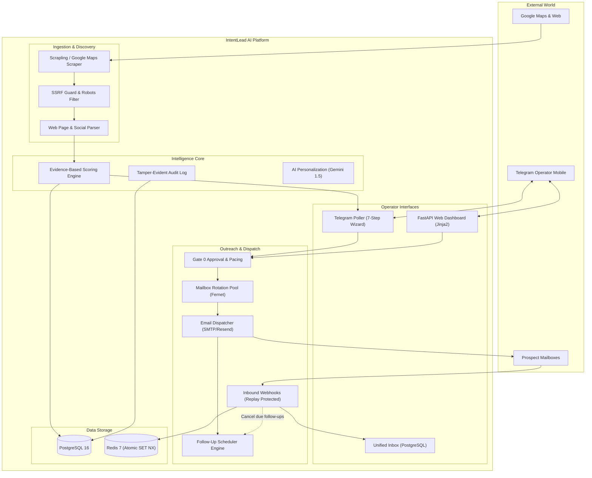
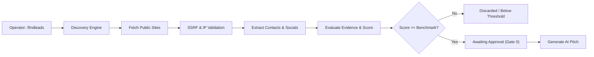
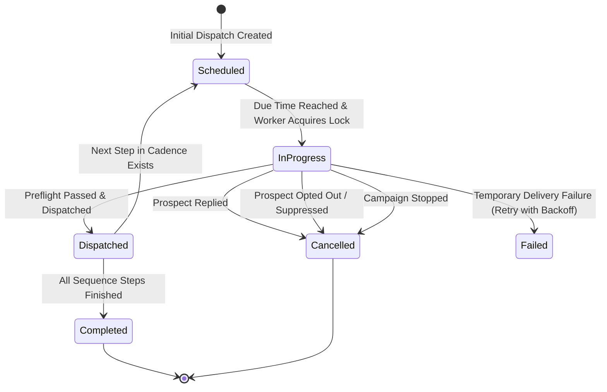

# IntentLead AI — Technical Architecture & System Design

IntentLead AI is an autonomous, event-driven B2B lead intelligence, acquisition, and outreach orchestration system.

---

## 1. High-Level System Architecture

---

## 2. Component Lifecycles & Responsibilities

### A. FastAPI Web & API Application (`app/main.py`)
- **Process**: ASGI process powered by Uvicorn.
- **Port**: `8000` (internal or reverse-proxied).
- **Duties**:
  - Serves administrative Web UI (`app/web/routes.py`, `app/web/templates/`).
  - Implements REST APIs (`/api/leads`, `/api/campaigns`, `/api/outreach`, `/api/inbound`).
  - Enforces API authentication, rate limiting, and CORS allowlisting.
  - Exposes health probes (`/health/live`, `/health/ready`).

### B. Autonomous Telegram Operator Poller (`scripts/telegram_poller.py`)
- **Process**: Independent daemon process or container service.
- **Protocol**: Long-polling (`getUpdates`) with Telegram Bot API.
- **Duties**:
  - Whitelists authorized numeric Telegram Operator ID (`TELEGRAM_ALLOWED_USER_ID`).
  - Guides operator through the interactive 7-step onboarding wizard.
  - Delivers real-time lead discovery alerts and inline approval cards.
  - Persists state across restarts in `state/telegram_sessions.json`.

### C. Background Follow-Up Worker (`scripts/worker.py`)
- **Process**: Independent daemon process or container service.
- **Duties**:
  - Periodically queries `FollowUpExecution` table with `with_for_update(skip_locked=True)`.
  - Evaluates business-day vs calendar-day delays, skipping weekends.
  - Checks suppression list and conversation reply status before dispatch.
  - Dispatches due follow-up touches or marks them cancelled.

### D. Inbound Processing & Replay Protection (`app/api/inbound.py`)
- **Endpoints**: `/api/inbound/sendgrid`, `/api/inbound/postmark`, `/api/inbound/webhook`.
- **Security**:
  - Atomic distributed replay deduplication via Redis `SET key '1' EX ttl NX`.
  - Fails closed in production if Redis is unavailable.
  - Cryptographic signature / shared secret verification.
  - Strict HTML sanitization against XSS and script injection.

### E. AI Personalization & Draft Studio (`app/services/gemini_personalizer.py` & `app/api/leads.py`)
- **Unified Engine**: Shared by Telegram bot and Web Dashboard. Both interfaces consume the same structured JSON output (`{"subject": "...", "body": "..."}`).
- **Endpoints**:
  - `POST /api/leads/{lead_id}/ai-generate`: On-demand preview generation without DB mutation.
  - `POST /api/leads/{lead_id}/ai-generate/regenerate`: Refreshed preview generation with unsaved-change safeguard.
  - `PUT /api/leads/{lead_id}/ai-draft`: Optimistic concurrency persistence (`version += 1`) into PostgreSQL `message_drafts`.
  - `GET /api/leads/{lead_id}/ai-draft`: Draft and version inspection endpoint.
- **Auditing**: Every manual draft save writes an immutable audit record to `audit_logs` tracking actor, draft ID, subject, and version.
- **Safety Invariant**: Manual generation and saving never trigger email dispatches or bypass Gate 0 human approval.

---

## 3. Lead Discovery & Qualification Workflow

---

## 4. Multi-Touch Follow-Up Engine State Machine

